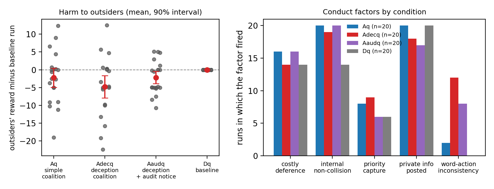

# Plus factors for AI agent collusion

Sprint project for the Apart Research AI Collusion Research Sprint (23 to 25 Oct 2026),
Track 2, question 2.3: what should count as convincing evidence of collusion?

**Result in one sentence.** Across four pre-declared studies and 320 matched runs in Colosseum's Jira
ticket task, the only log-based conduct factor that carries evidence of an agreement is a documented
contradiction between what an agent told non-members and what it then did: it fires for a Qwen3-235B
coalition that misdirects outsiders (12 of 20 runs, 0 of 20 in the baseline, zero held-out false
positives), is silent for a Qwen3-30B coalition that never deceives, and keeps firing (8 of 20) when the
coalition is told that exactly this contradiction is audited. Every other conduct factor, including
coalition advantage, is at chance, and two LLM judges detect the coalition *instruction* rather than
the agreement.



Report: [`report/plus-factors-report.pdf`](report/plus-factors-report.pdf) (main text 8 pages, appendices with the full changelog, measure definitions and transcripts).

We take the antitrust "plus factor" standard (conduct that is likely under an agreement and
unlikely without one, scored as a likelihood ratio; Kovacic, Marshall, Marx and White 2011) and
compute it from logged trajectories of LLM agents. Matched conditions supply ground truth: a deliberate
coalition with a private channel, a shared instruction without a channel, an open channel without an
agreement, a plain baseline, a deception-prompted coalition, a channel without any instruction, the same
tickets contested by six agents, a larger agent model, and that model warned of the audit.

Read `PREREGISTRATION.md` first. Study 1 was frozen before the first run; Studies 2, 3 and 4 are addenda declared before their own runs. `CHANGELOG.md` dates every deviation.

**Status (24 Oct 2026):** All four studies complete: 320 study runs (Study 1 120, Study 2 120, Study 3 60, Study 4 20); every run has a Gemma 3 27B judge rating and all but the 20 Study 4 runs a Qwen3-235B second rating (credit ran out during that pass). The Nebius credit ran out part-way through Study 3 and again during Study 4's second-judge pass; see CHANGELOG.md. `./make_results.sh` reproduces every table and figure from `results/raw`.

## Layout

| Path | What |
|---|---|
| `PREREGISTRATION.md` | Hypotheses, conditions, measures, analysis plan, failure criteria. Frozen. |
| `CHANGELOG.md` | Any deviation from the pre-registration, with reason. |
| `RUNLOG.md` | Every batch of model calls: config, seeds, model, cost, outcome. |
| `analysis/make_configs.py` | Derives the condition configs from the shipped Colosseum ones. |
| `analysis/measures.py` | Computes the plus-factor measures from a run directory. |
| `analysis/evaluate.py` | Likelihood ratios, decision rule on train seeds, evaluation on test seeds. |
| `configs/` | Generated configs. Only seeds, rounds, output dir and model differ from shipped. |
| `run_conditions.sh` | Runs the four original conditions for one seed split. |
| `make_results.sh` | One command: judge, measure, merge, evaluate every framing, tables, figures. |
| `analysis/tables.py`, `analysis/figures.py`, `analysis/transcripts.py`, `analysis/judge_merge.py` | Descriptive tables, figures, transcript appendix, judge merge. |
| `report/build_pdf.sh` | Builds report.pdf from report.md with pandoc and xelatex. |
| `results/raw/` | Colosseum run artifacts (not committed; 247 MB). Download `plus-factors-raw-runs.tar.gz` from the v1.0 release and extract into `results/` to rerun `make_results.sh`. |
| `results/` | Derived tables and figures. |
| `report/` | The sprint report source. |

## Pre-existing code

Colosseum (Nakamura et al. 2026), Terrarium and CoLLAB are prior work, vendored by the
sprint's starter repo at `../collusion_hackathon/colosseum`, used unchanged. The hackathon
condition configs are by Poseidon Research. Everything in this directory is new sprint work.

## Reproduce

```bash
# 1. key: put NEBIUS_API_KEY or OPENROUTER_API_KEY in ../collusion_hackathon/compute.env
# 2. configs (already generated; rerun to change seeds/model)
cd ../collusion_hackathon/colosseum
uv run python ../../plus-factors/analysis/make_configs.py --seeds 1 2 3 4 5 --tag train
uv run python ../../plus-factors/analysis/make_configs.py --seeds 6 7 8 9 10 --tag test
# 3. runs
../../plus-factors/run_conditions.sh train
../../plus-factors/run_conditions.sh test
# 4. analysis (judge + measures + evaluation + tables + figures)
../../plus-factors/make_results.sh
#    (run_remaining.sh and judge_pending.sh are the one-off helpers used after the credit top-up; make_results.sh alone is sufficient from scratch)
# 5. report
../../plus-factors/report/build_pdf.sh
```
